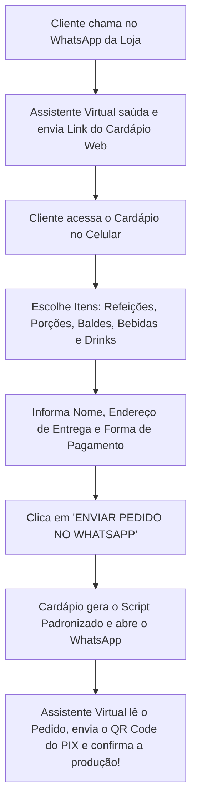

# 🥩 Cardápio Web - Churrasquinho do Ivanzinho

Cardápio online moderno, ultra rápido e otimizado para celulares (Mobile-First), integrado diretamente ao WhatsApp da loja com suporte a fluxo de atendimento automatizado por assistente virtual e geração de QR Code PIX.

---

## 📱 Fluxo de Atendimento Completo



---

## 🛠️ Tecnologias Utilizadas

- **HTML5 Semântico & Moderno**
- **Tailwind CSS (via CDN)**: Estilização responsiva de alta performance
- **Vanilla JavaScript (ES6+)**: Gerenciamento de carrinho, cálculo em tempo real e montagem do script do WhatsApp
- **Font Awesome 6 & Google Fonts (Bebas Neue + Plus Jakarta Sans)**
- **100% Client-Side**: Sem necessidade de servidores complexos, banco de dados ou instalações pesadas. Funciona direto em qualquer navegador e hospeda gratuitamente em 1 minuto.

---

## 📋 Itens e Preços Cadastrados (Fiel ao Cardápio Original)

### 1. Refeição Churrasco Misto
*(Acompanha arroz, farofa, vinagrete e salpicão)*
- **Individual (1 pessoa):** R$ 25,00
- **2 Pessoas:** R$ 49,00
- **3 Pessoas:** R$ 70,00
- **4 Pessoas:** R$ 95,00

### 2. Porção Mista de Carnes
*(Carne de boi, carne de porco, linguiça e frango)*
- **Individual (1 pessoa):** R$ 25,00
- **Pequena (2 pessoas):** R$ 45,00
- **Média (3 pessoas):** R$ 65,00
- **Grande (4 pessoas):** R$ 75,00

### 3. Extras & Acompanhamentos
- **Batata com Cheddar:** R$ 18,00
- **Batata Frita Tradicional:** R$ 15,00
- **Pão de Alho Recheado (unid.):** R$ 4,00

### 4. Balde de Cerveja (5 unidades)
- **Balde Brahma, Antártica ou Império (5 un):** R$ 35,00 *(com seletor da marca)*
- **Balde Amstel Lager (5 un):** R$ 40,00
- **Balde Heineken (5 un):** R$ 48,00

### 5. Bebidas & Refrigerantes
- **Refrigerante Lata (350ml):** R$ 8,00 *(com seletor de sabor)*
- **Coca-Cola 1,5L:** R$ 14,00
- **Refrigerante 1,5L Sabores (Laranja, Guaraná, Pepsi, Fanta Uva):** R$ 13,00 *(com seletor)*
- **H2O Limoneto:** R$ 8,00
- **Cerveja Império (Lata):** R$ 7,50
- **Cerveja Brahma (Lata):** R$ 7,50
- **Latão de Cerveja Amstel:** R$ 8,50
- **Latão de Cerveja Antártica:** R$ 7,50
- **Latão de Cerveja Heineken:** R$ 10,00
- **Água Mineral 500ml (Com ou Sem Gás):** R$ 4,00 *(com seletor)*
- **Guaravita:** R$ 4,00

### 6. Drinks & Copões
- **Copão de Gin:** R$ 15,00
- **Copão de Vinho (300 ml):** R$ 6,00

---

## 💬 Exemplo do Script Gerado para o WhatsApp

Quando o cliente clica no botão de enviar, a seguinte mensagem estruturada é enviada para o WhatsApp da loja:

```text
🔥 *NOVO PEDIDO - CHURRASQUINHO DO IVANZINHO* 🔥
━━━━━━━━━━━━━━━━━━━━━
👤 *Cliente:* João Pedro Silva
📱 *WhatsApp:* (21) 98888-7777
🛵 *Entrega para:*
📍 *Endereço:* Rua das Palmeiras, Nº 142
🏘️ *Bairro:* Campo Grande (Próximo à padaria)

📋 *ITENS DO PEDIDO:*
▫️ *1x* Refeição Mista - 2 Pessoas
   ↳ R$ 49,00
▫️ *1x* Balde Cerveja (5 Unidades) (Brahma)
   ↳ R$ 35,00
▫️ *1x* Refrigerante 1,5L Sabores (Guaraná)
   ↳ R$ 13,00

💰 *Subtotal dos Itens:* R$ 97,00
🛵 *Taxa de Entrega:* A calcular pela assistente
━━━━━━━━━━━━━━━━━━━━━
💳 *Forma de Pagamento:* PIX
📲 _(Aguardando o envio do QR Code / Chave PIX pela assistente)_

📝 *Observações do Cliente:*
"Por favor mandar o churrasco bem passado e sem cebola no vinagrete."
━━━━━━━━━━━━━━━━━━━━━
🤖 _Pedido gerado pelo Cardápio Web oficial._
_Por favor, confirme meu pedido e envie a chave/QR Code do PIX!_
```

---

## 🤖 Roteiro de Resposta para a Assistente Virtual (Chatbot / IA)

Se você utiliza **Typebot, Manychat, Chatwoot, Evolution API, Z-API, N8N ou OpenAI**:

### Mensagem 1: Ao receber uma saudação inicial do cliente
> "Olá! Seja muito bem-vindo ao **Churrasquinho do Ivanzinho**! 🥩🔥  
> Para ver nossos pratos, porções, baldes de cerveja trincando e montar seu pedido em menos de 1 minuto, acesse nosso cardápio online:  
> 👉 **[LINK_DO_SEU_CARDAPIO_AQUI]**  
>  
> Assim que finalizar no site, você será redirecionado de volta para cá com seu pedido prontinho e eu já te envio o QR Code do PIX para pagamento!"

### Mensagem 2: Ao receber a mensagem de "NOVO PEDIDO"
> "Sensacional, [Nome do Cliente]! Já recebi os detalhes do seu pedido! 📝🔥  
>  
> 💳 **Dados para Pagamento via PIX:**  
> Chave PIX (Celular/CNPJ): `suachavepixaqui`  
> Favorecido: Churrasquinho do Ivanzinho  
> Valor dos Itens: R$ [Valor] + Taxa de Entrega: R$ [Taxa]  
>  
> *(Ou envie a imagem do QR Code anexada)*  
>  
> ⏳ Assim que efetuar o pagamento, favor enviar o comprovante aqui para liberarmos imediatamente para a nossa grelha!"

---

## 🚀 Como Colocar no Ar (Hospedagem 100% Gratuita)

Como o projeto é em HTML/CSS/JS estático:

1. **Vercel / Netlify:**
   - Basta arrastar a pasta `cardapio-ivanzinho` para dentro do dashboard do [Netlify Drop](https://app.netlify.com/drop) ou subir para o GitHub e conectar na [Vercel](https://vercel.com).
2. **GitHub Pages:**
   - Crie um repositório no GitHub, faça o push destes arquivos e ative o GitHub Pages nas configurações do repositório.
3. **Localmente:**
   - Basta dar um duplo clique no arquivo `index.html` para abrir diretamente no seu navegador Chrome, Edge ou celular.
